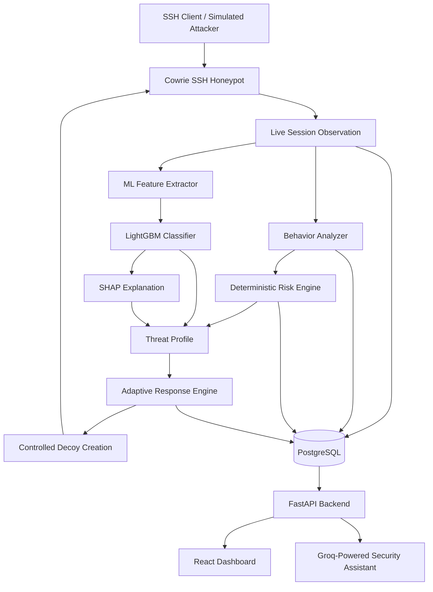

# AI-Powered Adaptive Honeypot for Intelligent Threat Profiling and Risk Assessment

An AI-assisted SSH honeypot that observes attacker activity, classifies session behavior using machine learning, calculates explainable threat risk, and responds with controlled deception.

## Overview

Traditional honeypots primarily capture suspicious interactions for later investigation. This project extends that approach by combining Cowrie SSH emulation with behavioral analysis, machine learning, explainable AI, deterministic risk scoring, and adaptive decoy generation.

The system observes commands executed during an SSH session, extracts behavioral and statistical features, identifies suspicious activity, predicts an attack category, and calculates a separate cumulative risk score. The resulting threat profile is stored in PostgreSQL and exposed through a FastAPI backend for visualization in a React dashboard.

A Groq-hosted large language model is integrated into the security assistant to provide natural-language explanations using available session and database context.

### Key Features

- **SSH Honeypot:** Cowrie-based SSH interaction monitoring in an isolated Docker environment.
- **Behavioral Analysis:** Rule-based detection of reconnaissance, file discovery, credential access, execution, persistence, and other suspicious behaviors.
- **Machine Learning:** LightGBM multiclass classification of nine session categories.
- **Explainable AI:** SHAP-based feature contribution analysis.
- **Risk Assessment:** Deterministic risk scoring based on observed behaviors, authentication information, and behavioral progression.
- **Adaptive Deception:** Controlled creation of virtual decoy files in the Cowrie environment.
- **Database Persistence:** PostgreSQL storage for sessions, commands, behaviors, risk assessments, adaptive actions, and decoys.
- **REST API:** FastAPI endpoints for authentication, session information, threat profiles, and dashboard data.
- **Security Dashboard:** React and Vite frontend for inspecting captured activity and threat assessments.
- **AI-Assisted Analysis:** Groq API integration for natural-language security explanations.

## Architecture



### Runtime Workflow

1. An SSH client connects to the Cowrie honeypot.
2. Cowrie emulates a Linux-like shell and records session events.
3. The live integration observes commands and detects behavioral indicators.
4. The behavior analyzer identifies suspicious activities using configurable rules.
5. The ML feature extractor generates statistical and command-derived features.
6. LightGBM predicts the session's most likely behavior category.
7. SHAP explains which features influence the model's prediction.
8. The risk engine independently calculates a cumulative risk score and severity state.
9. The adaptive response component can create controlled virtual decoys.
10. Session telemetry and analysis results are stored in PostgreSQL and exposed through FastAPI to the React dashboard.

The exact behavior and persistence of every component should be verified against the deployed configuration before production use.

## Machine Learning Design

### Classification Categories

The current classifier supports nine categories:

| Category | Description |
|---|---|
| `benign` | Routine or non-suspicious activity |
| `reconnaissance` | Initial system and environment exploration |
| `file_discovery` | Searching for files and directories |
| `credential_access` | Accessing account or credential-related information |
| `execution` | Executing commands or interpreters |
| `privilege_activity` | Privilege-related activity |
| `persistence` | Attempts to establish continued access |
| `file_modification` | Modifying or manipulating files |
| `multi_stage` | Activity combining multiple behavioral stages |

These are project-defined classification categories, not a complete taxonomy of real-world attacks.

### Dataset and Evaluation

The current training dataset was generated by executing controlled scenarios through Cowrie and reconstructing the resulting sessions.

| Dataset component | Details |
|---|---|
| Training dataset | 5,040 sessions |
| Training distribution | 560 sessions per class |
| Feature extraction | Shared production ML feature extractor |
| Model | LightGBM multiclass classifier |
| Independent evaluation | 180 sessions |
| Independent evaluation distribution | 20 sessions per class |
| Independent evaluation accuracy | 81.11% |
| Independent macro F1-score | 0.8030 |

The independent evaluation was conducted on generated sessions using a separate scenario-generation seed. It is useful evidence of generalization to those held-out scenarios, but it does not establish performance against arbitrary real-world attackers.

The model's current weaknesses include confusion between reconnaissance and file discovery, and lower recall for multi-stage sessions. More evaluation on diverse, independently collected real-world activity is needed before drawing broader conclusions.

### Feature Engineering

The ML feature extractor produces 33 raw features, including:

- Session duration and event counts
- Command counts and command diversity
- Command length statistics
- Command timing and inter-command gaps
- Shell metacharacters and redirection
- Absolute paths and command options
- Command-category counts
- Command transition statistics
- File modification, transfer, interpreter, and privilege-related indicators

Three constant or uninformative features were excluded during training, leaving **30 model input features**.

The ML pipeline is designed to keep predictive features separate from risk scores, risk states, and target labels to reduce target leakage.

### Explainability with SHAP

SHAP is used to explain model predictions by estimating how input features contribute to a prediction.

The threat profile includes influential features and their contribution values. These values explain the classifier's output; they are not equivalent to the deterministic risk score or proof that a particular malicious action occurred.

## Risk Assessment

The risk engine is independent of the LightGBM classifier.

It calculates a cumulative score using behavior weights, repetition limits, authentication indicators, and progression bonuses.

| Risk score | Risk state |
|---|---|
| 0–19 | LOW |
| 20–44 | MEDIUM |
| 45–69 | HIGH |
| 70 and above | CRITICAL |

Behavioral indicators can contribute different amounts to the score. For example, credential access, privilege-related activity, persistence, and defense evasion have higher configured weights than basic discovery behaviors.

The engine also considers combinations of behaviors that may indicate progression through an attack.

**Important distinction:**

- **LightGBM:** Predicts the session category that best matches the learned patterns.
- **SHAP:** Explains feature contributions to that prediction.
- **Risk engine:** Estimates severity using explicit scoring rules.

A predicted attack category does not automatically determine the risk state.

## Adaptive Deception

The adaptive response component can create controlled decoy files in Cowrie's virtual filesystem based on observed behaviors.

Examples include:

- `/tmp/system_backup.txt`
- `/tmp/system_info.txt`
- `/tmp/.credentials_backup.txt`

These paths represent illustrative decoys used in the controlled demonstration. Their availability depends on the current session and the adaptive response implementation.

Decoys are intended to observe subsequent attacker interaction and should never contain real credentials, secrets, or sensitive host information.

The project is designed for isolated laboratory testing. It must not execute arbitrary attacker commands on the host or modify the real host filesystem as part of its deception behavior.

## Technology Stack

| Component | Technology |
|---|---|
| Honeypot | Cowrie |
| Programming language | Python |
| Behavioral analysis | Python rule-based detection |
| Machine learning | LightGBM, scikit-learn |
| Explainable AI | SHAP |
| Database | PostgreSQL |
| Backend API | FastAPI, Uvicorn |
| Frontend | React, Vite, JavaScript |
| AI assistant | Groq API and hosted LLM |
| Containerization | Docker |
| Development environment | Ubuntu on WSL2 |

The security assistant uses an external LLM API. The project does not train or fine-tune its own LLM. A complete Chroma/embedding-based RAG retrieval pipeline is not claimed as a verified feature in this version.

## Project Structure

```text
ai-adaptive-honeypot/
├── adaptive/
│   ├── response_engine.py
│   ├── state_engine.py
│   ├── live_state_engine.py
│   ├── response_controller.py
│   └── live_cowrie_adapter.py
├── ai/
│   └── assistant.py
├── analyzer/
│   ├── rules.py
│   ├── behavior_analyzer.py
│   ├── threat_profiler.py
│   └── test_real_threat_profile.py
├── api/
│   └── main.py
├── collector/
│   └── session_collector.py
├── dashboard/
│   ├── app.py
│   └── frontend/
├── database/
│   └── db.py
├── data/
│   ├── raw/
│   ├── processed/
│   └── generated/
├── generator/
│   ├── scenarios.py
│   ├── run_scenarios.py
│   ├── feature_extractor.py
│   └── ml_feature_extractor.py
├── ml/
│   ├── train_lightgbm_baseline.py
│   ├── evaluate_independent_lightgbm.py
│   └── analyze_independent_errors.py
├── models/
│   └── lightgbm/
├── risk/
│   └── risk_engine.py
├── tests/
├── adaptive_db.py
├── requirements.txt
├── .gitignore
└── README.md
```

This tree highlights the main components; exact filenames and available artifacts may differ between project revisions. Cowrie's core source is maintained separately inside the Cowrie installation/container unless its custom modifications are explicitly included in the repository.

## Requirements

Recommended development environment:

- Windows 10/11 with WSL2 and Ubuntu, or a compatible Linux environment
- Python 3
- Node.js and npm
- Docker Desktop with WSL integration, or a compatible Docker Engine
- Git
- VS Code (optional)

The project requires sufficient memory and storage for Docker, Python dependencies, datasets, and trained models.

## Installation and Setup

### 1. Clone the repository

```bash
git clone https://github.com/YOUR_USERNAME/YOUR_REPOSITORY.git
cd YOUR_REPOSITORY
```

Replace the URL with your repository URL.

### 2. Create a Python environment

```bash
python3 -m venv .venv
source .venv/bin/activate
python -m pip install --upgrade pip
```

### 3. Install Python dependencies

```bash
python -m pip install -r requirements.txt
```

The `requirements.txt` file should contain the dependencies needed by the checked-in backend, ML, and database code. Verify it before publishing, and add missing dependencies if required.

### 4. Configure environment variables

Create a local `.env` file in the project root. Do not commit it.

Example template:

```dotenv
POSTGRES_HOST=localhost
POSTGRES_PORT=5432
POSTGRES_DB=honeypot
POSTGRES_USER=honeypot
POSTGRES_PASSWORD=CHANGE_ME

GROQ_API_KEY=YOUR_GROQ_API_KEY
GROQ_MODEL=openai/gpt-oss-120b
```

Use the actual environment-variable names expected by the current application code. If your configuration uses additional variables, document them in `.env.example`.

Generate strong local credentials, use placeholders in templates, and never publish real API keys, passwords, JWT secrets, or other credentials.

### 5. Start PostgreSQL

If you already have the configured container:

```bash
docker start honeypot-postgres
```

For a new local development container:

```bash
docker run -d \
  --name honeypot-postgres \
  -e POSTGRES_DB=honeypot \
  -e POSTGRES_USER=honeypot \
  -e POSTGRES_PASSWORD=CHANGE_ME \
  -p 5432:5432 \
  -v honeypot_postgres_data:/var/lib/postgresql/data \
  postgres:16
```

Use the same locally configured password in your environment variables.

Verify that PostgreSQL is ready:

```bash
docker exec honeypot-postgres \
  pg_isready -U honeypot -d honeypot
```

The application database schema must also be initialized using the project's database initialization procedure before the API can query the required tables.

### 6. Start Cowrie

The existing demonstration uses a Cowrie container named `cowrie` with SSH exposed on port `2222`.

If the container already exists:

```bash
docker start cowrie
docker ps
docker port cowrie
```

Test the local SSH connection:

```bash
ssh -p 2222 root@127.0.0.1
```

Exit the session with:

```bash
exit
```

**Custom integration requirement:** The live adapter and shell-hook modifications used by this project must be present in the Cowrie runtime. Pulling a fresh, unmodified Cowrie image is not sufficient to reproduce custom source-code changes. Before treating a fresh clone as reproducible, include the necessary patch/source files or documented setup steps for applying them.

Keep the honeypot bound to a controlled laboratory environment unless it has been deliberately isolated and secured for broader deployment.

### 7. Start the FastAPI backend

From the project root:

```bash
source .venv/bin/activate
uvicorn api.main:app --host 0.0.0.0 --port 8000 --reload
```

Check the health endpoint:

```bash
curl http://127.0.0.1:8000/health
```

Open the API documentation at:

http://127.0.0.1:8000/docs

Authentication may be required for protected endpoints. Follow the authentication flow implemented in the backend.

### 8. Start the React dashboard

Open a second terminal:

```bash
cd dashboard/frontend
npm install
npm run dev
```

Open the local URL printed by Vite, typically:

http://localhost:5173

The frontend requires the backend to be running and configured with the correct API URL.

### 9. Verify the integration

Before running the complete demonstration, verify that:

- Cowrie is accepting SSH connections.
- Commands are being captured in Cowrie logs.
- The collector and behavioral analysis modules work.
- The model and feature-name files are present.
- PostgreSQL is reachable from the components that write to it.
- The API can read the stored session data.
- The dashboard displays actual database values.
- The adaptive decoys are created in the Cowrie virtual filesystem as expected.

A successful server startup alone does not verify the complete end-to-end pipeline.

## Running a Controlled Demonstration

Use a dedicated SSH terminal:

```bash
ssh -p 2222 root@127.0.0.1
```

Inside the Cowrie session, execute benign discovery commands:

```bash
whoami
uname -a
ls
ls /tmp
cat /etc/passwd
```

Then inspect any decoys created during that particular session:

```bash
ls /tmp
cat /tmp/system_info.txt
cat /tmp/system_backup.txt
cat /tmp/.credentials_backup.txt
```

A decoy may not exist in every session. Its presence depends on the behaviors detected and the adaptive response logic.

Exit the session:

```bash
exit
```

Return to the dashboard to inspect the captured session, detected behaviors, predicted class, confidence, SHAP contributions, risk assessment, adaptive actions, and decoy records.

## Database Inspection

Connect to PostgreSQL:

```bash
docker exec -it honeypot-postgres \
  psql -U honeypot -d honeypot
```

Inspect recent sessions:

```sql
SELECT *
FROM sessions
ORDER BY created_at DESC
LIMIT 5;
```

Inspect recent commands:

```sql
SELECT session_id, command, timestamp
FROM commands
ORDER BY id DESC
LIMIT 20;
```

Inspect detected behaviors:

```sql
SELECT session_id, behavior, command_id
FROM behaviors
ORDER BY id DESC
LIMIT 20;
```

Inspect risk assessments:

```sql
SELECT session_id, risk_score, risk_state
FROM risk_assessments
ORDER BY id DESC
LIMIT 20;
```

Inspect adaptive actions:

```sql
SELECT session_id, action, risk_score, risk_state
FROM adaptive_actions
ORDER BY id DESC
LIMIT 20;
```

Inspect decoy records:

```sql
SELECT session_id, virtual_path, decoy_type
FROM decoys
ORDER BY id DESC
LIMIT 20;
```

Exit with:

```sql
\q
```

These queries assume the corresponding tables and columns have been initialized in the current database schema.

## API Endpoints

The current backend includes endpoints for the following operations:

| Endpoint | Purpose |
|---|---|
| `GET /health` | Check API and database health |
| `POST /auth/login` | Authenticate and obtain a token |
| `GET /auth/me` | Retrieve the authenticated user's information |
| `GET /dashboard/summary` | Retrieve dashboard summary data |
| `GET /sessions` | List sessions |
| `GET /sessions/{session_id}` | Retrieve session details |
| `GET /sessions/{session_id}/threat-profile` | Retrieve the ML and risk profile |
| `GET /dashboard/latest-threat` | Retrieve the latest threat information |
| `GET /decoys/{decoy_id}` | Retrieve decoy details |
| `POST /chat` | Ask the AI security assistant a question |

Some endpoints require authentication. Consult `/docs` for the current request schemas, query parameters, and response formats.

## AI-Assisted Security Analysis

The security assistant uses a hosted LLM through the Groq API to explain available security information in natural language.

Its context can include session details, observed behaviors, risk assessments, adaptive actions, and other database records available to the backend.

The assistant is intended to explain structured evidence rather than replace the deterministic risk engine or claim certainty beyond the collected data.

The current implementation should not be described as a completed retrieval-augmented generation system unless document retrieval, embedding generation, and vector-store search have been implemented and tested end to end.

## Security Considerations

- Run the honeypot in a controlled and isolated environment.
- Do not expose Cowrie to the public Internet without appropriate network isolation and operational safeguards.
- Do not place real credentials or sensitive information in decoy files.
- Keep `.env`, API keys, JWT secrets, database credentials, and private logs out of version control.
- Do not execute attacker-supplied commands directly on the host.
- Treat captured commands, logs, and attacker-provided strings as untrusted input.
- Protect the API with authentication and restrict database access.
- Use least-privilege access for containers and services.
- Avoid publishing raw logs that contain sensitive or identifying information.
- Use synthetic or sanitized data in public examples.

## Current Limitations

- The main ML training data consists of generated attack scenarios executed through Cowrie.
- The independent evaluation measures performance on held-out generated sessions, not all real-world attacker behavior.
- Multi-stage classification and several overlapping behavioral categories remain challenging.
- Rule-based risk scoring is configurable and should not be interpreted as a calibrated probability of compromise.
- Live session metadata and dashboard aggregation require end-to-end verification in the current deployment.
- Custom Cowrie integration changes must be preserved and documented for reproducible installation.
- The Groq integration depends on API availability, valid credentials, and the selected model.
- A complete Chroma-based RAG pipeline is not claimed as verified in this release.

## Future Improvements

- Improve classification of multi-stage and overlapping attack behaviors.
- Evaluate against more independently collected real-world sessions.
- Strengthen temporal, out-of-distribution, and calibration evaluation.
- Improve automated test coverage for the live Cowrie integration.
- Make session persistence and dashboard aggregation consistent.
- Package custom Cowrie modifications as reproducible patches.
- Improve auditability of adaptive actions and decoy lifecycle management.
- Add deployment documentation and security hardening.
- Evaluate a documented RAG knowledge base for security explanations if retrieval is added.

## Project Status

This project demonstrates an integrated research prototype combining SSH honeypot telemetry, behavioral analysis, machine learning, explainability, deterministic risk scoring, adaptive deception, a database-backed API, and a web dashboard.

Core components have been implemented and tested individually and in selected integration paths. The remaining work is to verify consistent live persistence, correct dashboard aggregation, reproducible Cowrie customization, and complete end-to-end operation before claiming a fully production-ready system.

## Author

**Sarang S**

MCA Graduate | AI, Machine Learning, and Cybersecurity

## License

Choose and add a license before distributing the repository. If the project includes or modifies Cowrie, review and comply with Cowrie's applicable license and attribution requirements as well.
